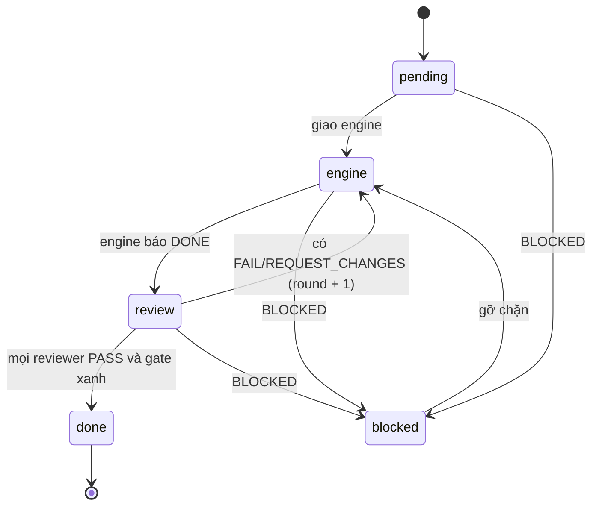
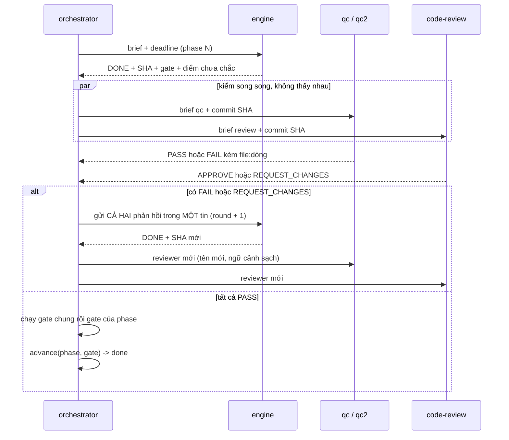

# 01 - Quy trình từng bước

Mỗi bước có **đầu vào**, **việc làm**, **DoD** (Definition of Done: điều kiện để coi bước là xong).

## Ba bên và ranh giới

| Bên | Làm | KHÔNG làm |
|---|---|---|
| **Người dùng** | Trả lời câu hỏi thiết kế. Duyệt gói thiết kế. Quyết định khi có đánh đổi. Thông báo "đã ổn" để vào `develop`. Quyết định phát hành. Quyết định ngoại lệ cho cổng chặn. | Không phải đọc diff từng dòng. Không phải tìm thông tin agent tự tra được. |
| **Orchestrator** (phiên điều phối) | Đọc gói thiết kế. Ghi board. Giao việc cho child kèm deadline. Gộp verdict. Chạy gate. Merge. Kích CI. Deploy. Kiểm. Ghi ticket. Báo người dùng. | **Không tự sửa mã, test, fixture, kể cả sửa "nhỏ".** Mọi sửa mã đi qua một engine được giao. Không tự nới cổng chặn. Không tự phát hành. |
| **Child** (engine, qc, qc2, code-review, documenter, research, verifier...) | Làm đúng một việc được giao, trong ngữ cảnh sạch. Báo cáo với dòng trạng thái đầu tiên. | Không mở rộng phạm vi. Không tự `push`/tag. Không sinh child con. Không đụng việc của vai khác. |

Lý do orchestrator không sửa mã: nó giữ ngữ cảnh của cả dự án và đóng vai người quyết định. Nếu nó tự sửa, nó vừa viết vừa chấm bài của chính mình, và bản sửa "nhỏ" không đi qua review.

## Sơ đồ trạng thái của một phase

`blocked` nhớ trạng thái trước nó và quay lại đúng chỗ đó. Phase `blocked` không thể bị đóng nhầm.

## Các bước

### Bước 0 - Tiếp nhận

- **Việc:** nhận ý tưởng hoặc ticket. Mở ticket theo dõi (nếu chưa có). Kiểm không có phiên điều phối khác đang giữ cùng board (xem mục "Một người ghi board" bên dưới).
- **DoD:** có ticket, có nhánh `feature/<ticket>-<slug>` cắt từ `develop`.

### Bước 1 - Thiết kế (skill `thinker`)

- **Đầu vào:** ý tưởng thô.
- **Việc:** đọc repo trước (README, quy tắc agent, PRD cũ, mã liên quan, lệnh test và CI). Chỉ hỏi người dùng điều không có trong repo, theo cây quyết định (skill `grilling`). Gọi tên các vấn đề thiết kế. Cân 2-3 phương án và ghi phương án bị loại. Viết `docs/design/<slug>/{prd,srs,design,phases}.md`. **Chạy thử lệnh gate trước khi ghi vào `phases.md`.**
- **DoD:**
  - [ ] Mỗi `REQ-xxx` có phương pháp kiểm: `Test`, `Demonstration`, `Inspection` hoặc `Analysis`.
  - [ ] Mỗi `REQ` nằm trong đúng một phase.
  - [ ] 3-7 phase. Không phase nào giữ hơn khoảng một phần ba số yêu cầu.
  - [ ] Gate chung xanh trên cây hiện tại. Gate riêng của mỗi phase đỏ (hoặc chưa chạy được). Gate riêng đã xanh nghĩa là việc đó đã xong rồi.
  - [ ] Mỗi dòng gate là một lệnh, không nối bằng `&&`.
  - [ ] Người dùng duyệt gói.
- **Đầu ra:** thư mục gói thiết kế. Mẫu: [`mau/goi-thiet-ke/`](mau/goi-thiet-ke/).

### Bước 2 - Khởi tạo orchestrator

- **Việc:** copy từng `## Phase N` lên board (`board.add_phase`). Kiểm `board.uncovered` rỗng. Chạy gate chung **một lần trên cây sạch**. Chọn model theo vai và ghi vào board.
- **Kết quả gate chung:**
  - Xanh: đi tiếp.
  - Đỏ vì mã: repo hỏng từ trước. Báo người dùng. Không giao engine sửa thứ chưa ai yêu cầu.
  - Không chạy được (thiếu công cụ, thiếu quyền, không tới được host): chặn cả đợt. Báo lệnh và lỗi, dừng.
- **DoD:** board có đủ phase, mỗi phase có `req_ids`, `acceptance`, gate. Gate chung đã chạy.

### Bước 3 - Lặp cho từng phase

1. **engine** làm đúng một phase: lập kế hoạch ngắn, viết test đỏ trước, viết mã, chạy toàn bộ test. Commit sớm, từng bước nhỏ, trên nhánh feature. Không `push`.
2. **qc** chấm diff **theo acceptance của phase**, từng `REQ` một: PASS hoặc FAIL kèm thứ còn thiếu. Dùng đúng phương pháp kiểm ghi trong SRS. Không kiểm được thì là FAIL, không phải PASS.
3. **qc2** (nếu dùng) chấm cùng brief nhưng model khác, độc lập. Mục đích: bắt thứ qc bỏ sót (nhánh lỗi, dữ liệu biên, lộ bí mật).
4. **code-review** đọc và áp dụng skill `ponytail-review` (v5). Đây là review **chất lượng đầy đủ**, không chỉ tìm mã thừa. Thứ tự quan trọng: **đúng, an toàn, chịu tải, có test, nhanh, gọn** (xoá hơn thêm). Reviewer đọc **cả mã liên quan** (nơi gọi hàm đã đổi, hàm được gọi, test, README), không chỉ diff, và ước tải mong đợi từ repo. Không chấm requirement (việc của qc). Trả `APPROVE` hoặc `REQUEST_CHANGES`. Mỗi phát hiện có mức độ (`BLOCKER`, `MAJOR`, `MINOR`, `NIT`), `file:dòng`, ca cụ thể làm hỏng, cách sửa nhỏ nhất và hậu quả nếu bỏ qua. Chi tiết ở [`02`](02-vai-tro-va-brief.md#code-review).
5. Orchestrator **chờ đủ** các reviewer rồi mới quyết. Mới có một phản hồi chưa phải verdict.
6. Quy tắc gộp: **FAIL hoặc REQUEST_CHANGES của bất kỳ ai** là một vòng sửa. Khác biệt giữa các reviewer ghi vào báo cáo (đó là dữ liệu để chọn lại model).
7. Tất cả PASS: orchestrator tự chạy gate (chung trước, riêng sau, lệnh rẻ nhất trước, dừng ở lệnh đỏ đầu tiên).
8. Gate đỏ là việc của engine, không phải phát hiện của reviewer. Gửi lệnh và output cho engine. Phase ở lại `review`.

**DoD của phase:** mọi reviewer PASS **và** mọi lệnh gate thoát 0 **và** các lệnh đó do orchestrator chạy, ghi vào board bằng `advance(..., gate=results)`.

### Bước 4 - Merge vào nhánh test, CI, deploy cụm test

- **Việc:** merge `feature/*` vào `test` (xem [`03`](03-gitflow-va-release.md)). Kích CI **sau khi** merge đã đẩy xong và đã kiểm SHA. CI build, chạy gate, gắn tag `TEST-<n>` (nếu repo dùng), deploy cụm test.
- **Một build CI một lúc.** Môi trường test và agent CI là tài nguyên dùng chung. Hai build chồng nhau ghi đè nhau hoặc làm hết đĩa.
- **Kiểm đúng bản:** log build phải có dòng checkout đúng SHA đã merge. Đã có lần CI chạy trên SHA cũ vì merge chưa đẩy kịp.
- **Chờ rollout xong** rồi mới kiểm. Lệnh apply trả về trước khi pod mới phục vụ.
- **DoD:** CI xanh, tag có thật, image ghim bằng digest hoặc tag bất biến, pod mới phục vụ.

### Bước 5 - Verifier

- **Việc:** một phiên **khác với phiên deploy** chạy e2e và quét bảo mật trên bản đã deploy, cộng các yêu cầu phi chức năng kiểu `Demonstration` hoặc `Analysis`. Quyết định ship hay không.
- **Kết quả:**
  - `PASS`: sang bước 6.
  - Lỗi chặn: mỗi lỗi thành một **phase mới** (`fix: ...`). Phase đã `done` không mở lại, để giữ hồ sơ cái đã ship.
  - `BLOCKED` (môi trường hỏng): báo người dùng. Không ship khi verifier chưa chạy được. Không coi im lặng là PASS.
- **DoD:** có verdict viết ra, kèm bằng chứng (lệnh và output).

### Bước 6 - Documenter

- **Việc:** cập nhật `docs/design/<slug>/` và tài liệu sống của repo cho khớp **cái đã ship**. Không viết lại lịch sử: ghi cái gì đổi và vì sao. Không bịa tài liệu cho thứ chưa ai làm.
- **DoD:** cổng tài liệu (`scripts/check-docs.sh`) xanh. Diff tài liệu được review (xem bài học về tài liệu gọn ở [`05`](05-bai-hoc.md)).

### Bước 7 - Vào develop và phát hành

- **Vào `develop`:** CHỈ khi người dùng thông báo tính năng đã ổn trên cụm test. MR từ `feature/*`.
- **Phát hành:** cắt `release/<YYYY.MM.DD>` từ `develop`, MR vào `master`, CI gắn tag `MASTER-<n>`, merge ngược `master` về `develop`. Chi tiết và checklist ở [`03`](03-gitflow-va-release.md).
- **DoD:** tag `MASTER-<n>` có thật, `develop` không tụt so với `master`, ticket được đóng kèm comment tổng kết.

## Nhật ký ticket (mỗi mốc một comment)

Board là bản đầy đủ. Ticket là bản trace công khai. Orchestrator ghi comment ở **mỗi mốc**:

| # | Mốc | Nội dung tối thiểu |
|---|---|---|
| 1 | Mở việc | ticket, nhánh, worktree, model từng vai |
| 2 | engine DONE | HEAD, số commit, số test trước và sau |
| 3 | Mỗi vòng review | verdict **từng** reviewer, phát hiện chính (BLOCKER/MAJOR) kèm `file:dòng` |
| 4 | Sửa (rework) | gửi gì, HEAD mới |
| 5 | Gate | lệnh, exit code, số test |
| 6 | Phát hành | MR, commit merge, số build CI, tag |
| 7 | Chặn hoặc quyết định của người dùng | nội dung và ngày giờ |

- Dòng đầu: `**Nhật ký phase N (orchestrator, dd/mm/yyyy)**`. Có giờ. Không chứa bí mật. Liên kết chéo giữa các repo.
- Đóng ticket chỉ khi đã phát hành và có comment tổng kết. Việc `MINOR`/`NIT` không chặn thì mở ticket phụ.
- Mẫu: [`mau/ticket-mau.md`](mau/ticket-mau.md).

## Deadline và watchdog

Child chạy dài mà không có mốc giờ thì không ai biết nó treo hay đang làm.

- **Mọi brief cho child chạy lâu có mốc giờ:** PROGRESS giữa chừng, kết quả cuối (chưa xong vẫn gửi cái đã có), dọn dẹp.
- **Lấy giờ bằng đồng hồ máy** (`datetime.now()`) trước khi đặt mốc. Đã có lần đoán giờ lệch hơn một tiếng và phải gửi lại brief.
- **Brief bắt buộc ba điều:** bọc mọi lệnh có thể treo bằng `timeout <giây>`; chạy service trong container bằng `docker run -d`; chạy `curl -m 10`.
- **Watchdog** (heartbeat 30 phút):
  - child đang chạy mà im hơn 15 phút: gửi MỘT tin nhắc ("bọc lệnh dài bằng `timeout` hoặc báo trạng thái").
  - im hơn 60 phút: chỉ báo người dùng.
  - Không xoá child. Không tắt watchdog khi còn child đang `running`, dù child đó trông đã treo.
- **Child treo trong lệnh:** xem CPU của kernel child (`ps -Ao pid,etime,pcpu,command`), nối tiến trình với worktree của nó (`lsof -p <pid> | grep cwd`), loại tiến trình của chính mình. SIGINT thường bị bỏ qua, SIGTERM trên kernel của child thường đưa nó về trạng thái rỗi và nó gửi nốt kết quả.
- **Child báo rỗng ngay lập tức** (`no-reply`): thường là nhà cung cấp model không tới được. Chạy `curl -m 10` tới nhà cung cấp trước khi spawn lại. Không spawn lại mù trên cùng nhà cung cấp.

## Quy tắc review nhiều vòng

1. Vòng 1: engine DONE, các reviewer chạy song song, mỗi reviewer là **phiên mới** (tên có số vòng, ví dụ `qc-p3-r1`).
2. Có `REQUEST_CHANGES` hoặc `FAIL`: orchestrator gửi **tất cả** phản hồi cho engine trong **một** tin. Không gửi engine hai lần cho cùng một vòng.
3. Engine sửa, báo SHA mới. Vòng 2 dùng reviewer mới (`qc-p3-r2`). Reviewer cũ không được dùng lại: ngữ cảnh sạch là lý do review bắt được lỗi.
4. Lặp đến khi tất cả PASS. Mỗi vòng ghi board và ticket.
5. Orchestrator kiểm diff cuối bằng mắt: phản hồi "đã sửa" của engine không phải bằng chứng. Với bản sửa nhỏ chỉ chạm tài liệu, có thể bỏ review đầy đủ nhưng phải kiểm diff không đụng `src/`, test, hay file khoá phụ thuộc.
6. Reviewer không thấy phản hồi của nhau. Hai reviewer đồng ý vì một người đọc người kia chỉ là một reviewer.
7. Phát hiện chưa chặn (`MINOR`/`NIT`): ghi vào ticket phụ, không chặn phase.
8. Thường cần **2 vòng**. Tối đa **3 vòng**. Sang vòng 4 mà còn phát hiện chặn thì orchestrator dừng, xem lại thiết kế hoặc phạm vi phase rồi mới quyết (không tự mở vòng 4 mù).
9. Reviewer **tự đo lại**, không tin lời engine: chạy probe, chạy trên bản sao của cây, so bản cũ với bản mới (A/B). Câu "đã sửa", "test xanh" của engine chỉ là điểm xuất phát (bài học 26 và 27 ở [`05`](05-bai-hoc.md)).
10. Với thay đổi chạm quyết định bảo mật, chạy **review bảo mật** (code-review) và **QC fuzz vi sai với hệ thống chuẩn** (qc, qc2) **song song**. Hai bên tìm hai loại lỗi khác nhau (bài học 28).

## Khi nào hỏi người dùng

**Hỏi:**
- Ngoại lệ cho một cổng chặn đang đỏ (ví dụ cho phép hạ phiên bản một thư viện).
- Thay đổi hành vi đã được chốt là chuẩn (lệch khỏi hệ thống tham chiếu).
- Bất cứ thứ gì nới bảo mật: tắt xác thực, bỏ kiểm quyền, xoá bản ghi.
- Kích CI khi người dùng có thể đang chạy một luồng khác trên cùng agent.
- Quyết định phát hành, deploy production, đổi DNS hoặc proxy.
- Mâu thuẫn với một ADR. **Dừng và báo, không tự lách ADR.**
- Child báo `BLOCKED` mà orchestrator không tự gỡ được.
- Phát hiện lỗi nặng ngoài phạm vi phase (tạo ticket và hỏi có làm ngay không).

**Không hỏi:**
- Thứ agent tra được trong repo hoặc đo được trên hệ thống thật.
- Quyết định cục bộ, rủi ro thấp: chọn cách đơn giản nhất, nói một lần.
- Việc đã có luật trong repo (gitflow, tên nhánh, cách ghim phụ thuộc).

Khi hỏi: nêu phương án khuyến nghị, hậu quả mỗi phương án, và cái gì dừng lại nếu chưa có trả lời.

## Một người ghi board

Board không ghi ai đang giữ nó. Trước khi một orchestrator **mới** tiếp tục phase từ board:

- [ ] Liệt kê phiên đang chạy (lệnh liệt kê của công cụ agent) và tìm phiên điều phối khác cùng thư mục, cũng như child trùng tên (ví dụ `engine-p4`).
- [ ] Đọc tin đầu và các tin gần nhất của từng phiên. Đừng đoán theo trạng thái "đang chạy".
- [ ] Thấy phiên khác đang làm: **chỉ báo người dùng hoặc nhắn phiên đó.** Không ghi board, worktree hay ticket.

Một sự cố thật: phiên thứ hai thấy phase ở trạng thái FAIL, mở vòng 3 và spawn engine thứ hai trong khi phiên thứ nhất đang có engine sửa cùng worktree. Kết quả là hai engine ghi đè file của nhau.

## Quy tắc vận hành khác

- **Không xoá child** sau khi xong phase (luật của dự án gốc: người dùng muốn thấy mọi agent đã tham gia; vết nằm ở file verdict và ticket). Skill `orchestrator` bản gốc nói ngược; đội bạn tự chọn một trong hai, nhưng phải ghi vào quy tắc agent.
- **Brief của việc build/deploy** phải nói rõ: chỉ được dọn cache build và xoá image Docker của dự án này. Cấm xoá file ngoài Docker (cache của home, dự án khác). Thiếu đĩa thì dừng và báo `BLOCKED`. Brief phải yêu cầu liệt kê chính xác mọi thứ đã xoá.
- **Production chỉ được đọc** trong mọi brief nghiên cứu và kiểm: chỉ `GET`, không tạo, sửa, xoá.
- **Không in bí mật** (mật khẩu, token, khoá) ra log, báo cáo hay file.
- **Ghim số ADR trong brief** khi chạy nhiều engine song song (xem [`05`](05-bai-hoc.md)).
