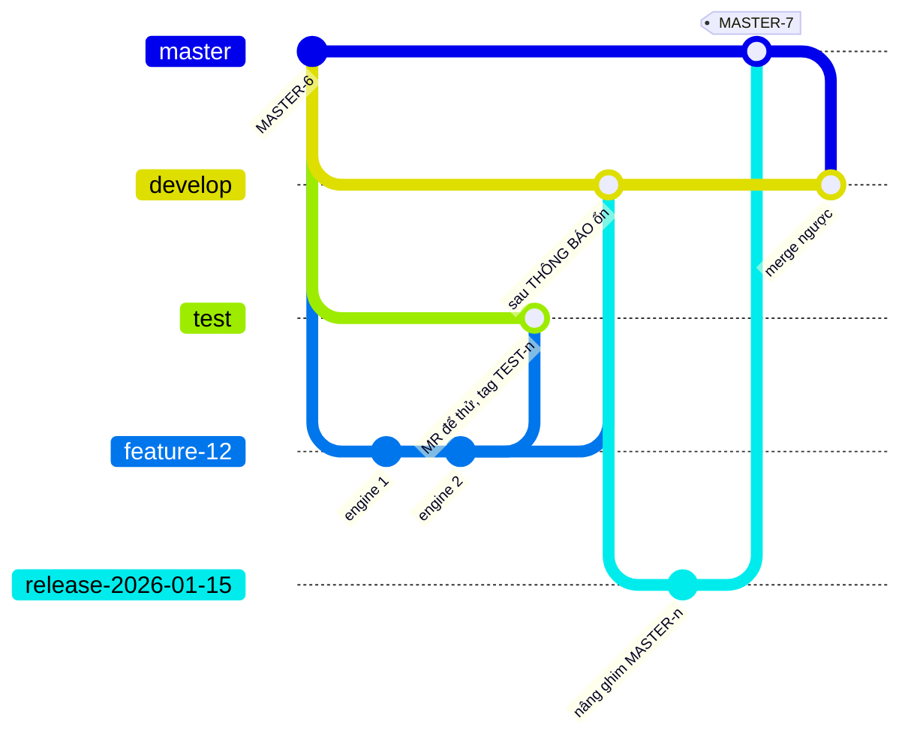

# 03 - Gitflow, tag và phát hành

Một khối gitflow chung dùng cho mọi repo của dự án. Nếu dự án có nhiều repo, chép **giống từng byte** khối này vào tài liệu gitflow của từng repo, và có một cổng kiểm so các bản (lệch là đỏ).

## Nhánh

| Nhánh | Tạo từ | Đi đâu |
|---|---|---|
| `develop` | - | Nhánh tích hợp. Chỉ nhận `feature/*` đã ổn trên cụm test và `hotfix/*`. |
| `test` | - | Nhánh kiểm thử. CI build và deploy lên cụm test. Nhiều tính năng thử song song được. |
| `master` | - | Mã production. Nguồn phát hành DUY NHẤT. |
| `feature/<ticket>-<slug>` | `develop` | MR vào `test` để thử. CHỈ khi có THÔNG BÁO mới vào `develop`. |
| `release/<YYYY.MM.DD>` | `develop` | MR vào `master`, rồi merge ngược `master` về `develop`. |
| `hotfix/<ticket>` | `master` | MR vào `master`, rồi merge ngược về `develop` (và `test` nếu bản đó còn dùng). |

(Sơ đồ viết tên nhánh dạng `feature-12`, `release-2026-01-15` cho dễ vẽ. Tên thật theo bảng trên: `feature/12-<slug>`, `release/2026.01.15`.)

## Luồng

1. Cắt `feature/<ticket>-<slug>` từ `develop`. Xong việc: MR vào `test` để thử trên cụm test.
2. CHỈ khi có THÔNG BÁO (tính năng đã ổn trên cụm test) mới đưa feature vào `develop` bằng MR.
3. Phát hành: cắt `release/<YYYY.MM.DD>` từ `develop`, MR vào `master`. Sau khi lên `master`, merge ngược `master` về `develop`.
4. Sửa gấp production: cắt `hotfix/<ticket>` từ `master`, MR vào `master`, rồi merge ngược về `develop` (và `test` nếu cần).
5. Xoá nhánh `feature/*`, `release/*`, `hotfix/*` sau khi đã vào đích.

## Tag

| Tag | Ai gắn | Khi nào | Dùng để |
|---|---|---|---|
| `MASTER-<n>` | CI, job nhánh `master` | SAU khi gate xanh | Bản phát hành. Bên dùng ghim đúng tag này. |
| `TEST-<n>` | CI, job nhánh `test` | SAU khi gate xanh | Bản thử trên cụm test. Chỉ repo thư viện có. |

- `<n>` thường là số build của job CI. Build đỏ vẫn chiếm số, nên dãy tag nhảy cóc là bình thường.
- **Tag là bất biến.** Không dời tag đã có. **Không bao giờ gắn tag tay**: nếu cần số mới, chạy lại job để lấy số kế tiếp.
- Số tag của các repo khác nhau KHÔNG song song. Đối chiếu bằng lệnh liệt kê tag của từng repo.

## Luật chung

- KHÔNG merge `test` vào `develop` hay `master`: `test` có thể đang chứa tính năng chưa xong của người khác.
- KHÔNG commit thẳng lên `test`, `develop`, `master`. Luôn đi qua Merge Request.
- Tên nhánh phải đúng mẫu ở bảng trên. Một nhánh tên lạ (ví dụ `revert/*`) có thể bị cổng ghim phụ thuộc chặn ở mọi build. Muốn hoàn tác thì cắt `feature/<ticket>-...` (từ nhánh đang chứa thứ cần hoàn tác, xem bài học trong [`05`](05-bai-hoc.md)).
- Merge `master` vào `test` chỉ khi hotfix khẩn.
- Một feature đã chứa sẵn các merge đã giải xung đột của feature khác thì merge **nó** trước. Làm ngược lại sinh xung đột.

## Ghim phụ thuộc theo nhánh

Khi một repo dùng thư viện do repo khác phát hành (dự án gốc: ứng dụng ghim thư viện logic và thư viện lõi), ghim bằng **tag**, không bằng `rev` hay `branch`. Luật theo nhánh:

| Nhánh của repo dùng | Được ghim |
|---|---|
| `test`, `feature/*` | `TEST-<n>` hoặc `MASTER-<n>` |
| `develop`, `release/*`, `hotfix/*`, `master` | CHỈ `MASTER-<n>` |

- **Lý do:** bản `TEST-<n>` chưa qua nhánh `master` có thể bị bỏ. Không được lọt vào `develop` hay `master`.
- **Đừng để nhánh vào `develop` còn ghim `TEST-<n>`.** Trước khi vào `develop`, đổi sang `MASTER-<n>` tương ứng và ghi bằng chứng.
- **Cổng ghim chạy ở stage đầu của CI** (`Initialize`), trước mọi bước nặng. Nhánh không xác định được thì áp luật chặt nhất, không pass ngầm.
- **Nâng phiên bản đồng thời:** hai thư viện nằm trong cùng cây phụ thuộc phải ghim cùng một bản. Nâng cả hai trong MỘT nhánh và MỘT file khoá. Khi đổi tag của thư viện lõi ở một repo, báo trước repo kia và chờ họ sẵn sàng nâng cùng lúc: nếu không, build của họ đỏ vì hai nguồn cho cùng một thư viện.
- **Sau mỗi lần cập nhật file khoá:** đọc `git diff` của file khoá. Chạy cổng chặn hạ phiên bản (không crate/package nào được bị hạ). Bỏ một phụ thuộc làm các bản của riêng nó biến mất là **xoá**, không phải hạ. Cổng chặn không được tự thêm ngoại lệ: ngoại lệ do người dùng chốt, kèm ticket và số đo trong lý do.

## Checklist phát hành

### Trước khi phát hành

- [ ] Người dùng đã thông báo phát hành.
- [ ] Tính năng đã ổn trên cụm test.
- [ ] Thư viện phụ thuộc đã có tag `MASTER-<n>` (kiểm bằng lệnh liệt kê tag từ xa).
- [ ] Nếu có nội dung ghép từ repo khác (ví dụ giao diện web): đã chốt phiên bản với chủ của nó.
- [ ] Không còn nhánh nào ghim `TEST-<n>` trong những thứ sắp vào `master`.

### Các bước

- [ ] 1. `git checkout develop && git pull`, rồi `git checkout -b release/$(date +%Y.%m.%d)`.
- [ ] 2. Nâng ghim các thư viện lên `MASTER-<n>`. Cập nhật file khoá. Đọc diff file khoá.
- [ ] 3. Chạy các cổng cục bộ: ghim, một bản duy nhất của thư viện dùng chung, chống hạ phiên bản, tài liệu. (Lệnh thật là việc của repo bạn.)
- [ ] 4. Tạo MR từ `release/*` vào `master`. Chờ CI xanh. Người có thẩm quyền merge.
- [ ] 5. Job CI nhánh `master` chạy: build, quét lỗ hổng, đẩy image, gắn tag `MASTER-<n>`. **Không gắn tag tay.**
- [ ] 6. Merge ngược `master` về `develop` bằng MR. Xoá nhánh `release/*`.
- [ ] 7. Deploy production theo runbook. Việc đổi DNS hoặc proxy do người dùng thực hiện.
- [ ] 8. Kiểm sau phát hành (bên dưới).
- [ ] 9. Ghi comment tổng kết vào ticket: tag, SHA, số build, ngày giờ. Đóng ticket.

### Kiểm sau phát hành

- [ ] Tag `MASTER-<n>` có trên remote.
- [ ] Image có trong registry (kiểm manifest).
- [ ] Endpoint metric trả số liệu; log khởi động in đúng phiên bản hoặc digest của dữ liệu nhúng.
- [ ] Một request thật đi đúng đường và trả mã dự kiến.

### Hotfix

- [ ] Cắt `hotfix/<ticket>` từ `master`.
- [ ] Sửa, chạy cổng, MR vào `master`. Nếu CI cần tham số (ví dụ phiên bản nội dung đang chạy production), điền BẮT BUỘC.
- [ ] Sau khi vào `master`: build `master` lại để có tag `MASTER-<n>` chính thức.
- [ ] Merge ngược `master` về `develop` (và `test` nếu còn dùng).
- [ ] Lưu ý: hotfix cắt từ `master` cũ có thể đỏ ngay ở cổng ghim cho tới khi nâng ghim và cập nhật file khoá.

### Rollback

- Quay về image trước (tag `MASTER-<n-1>`), hoặc đổi proxy về upstream cũ.
- Đặt mục tiêu thời gian rollback (ví dụ dưới 5 phút) và ghi lệnh thật vào runbook trước ngày phát hành.
- Sửa route/dữ liệu nhúng sai: phát hành bản mới, hoặc quay về tag trước.

## Bảng sự cố thường gặp

| Triệu chứng | Nguyên nhân | Xử lý |
|---|---|---|
| CI đỏ ở cổng ghim: `TEST-<n>` trên `release/*`/`master` | Nhánh chỉ nhận `MASTER-<n>` | Đợi thư viện phát hành `MASTER-<n>`, sửa file cấu hình, chạy lại |
| CI đỏ: hai nguồn cho cùng thư viện trong file khoá | Một thư viện lõi đổi tag mà repo kia chưa nâng | Nâng đồng thời cả hai, một nhánh |
| Cổng chống hạ phiên bản đỏ | Cập nhật vô tình hạ một package gián tiếp | Sửa tay khối của package về bản cũ, kiểm lại. KHÔNG tự thêm ngoại lệ |
| Image đã đẩy nhưng build đỏ, repo chưa có tag | Bước gắn tag phụ (nội dung ghép) xung đột | Xác nhận phiên bản đúng, chạy lại job để lấy số kế tiếp. KHÔNG đẩy tag tay |
| CI chạy trên SHA cũ | Merge chưa đẩy xong lúc kích CI | Kích sau khi kiểm `origin/<nhánh>` bằng đúng SHA đã merge |
| Build treo hàng chục giờ, đĩa agent đầy | Agent dùng chung, job không tự dọn | Thêm timeout cho job, dọn image và cache của chính job sau build. Với phần ngoài tầm repo: báo quản trị CI |
