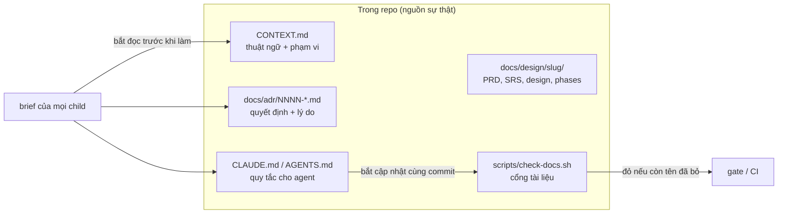
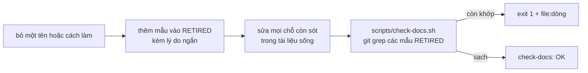

# 04 - Tài liệu cho agent đọc

Agent không nhớ gì giữa các phiên. Cái nó biết về dự án chỉ là cái nằm trong repo. Vì vậy tài liệu là **hạ tầng của quy trình**, không phải thứ làm sau.

## Một sự thật một nơi

Mỗi loại nội dung chỉ nằm ở một chỗ. Nơi khác chỉ trỏ tới.

| Nội dung | Nơi duy nhất |
|---|---|
| Tổng quan, build, deploy, kiểm thử | `README.md` |
| Thuật ngữ, phạm vi | `CONTEXT.md` |
| Quyết định đã chốt, kèm lý do | `docs/adr/NNNN-*.md` |
| Quy trình nhánh và phát hành | `docs/gitflow.md` |
| Yêu cầu, thiết kế, phase, bằng chứng kiểm | `docs/design/<slug>/` |
| Quy tắc cho agent | `CLAUDE.md` hoặc `AGENTS.md` |
| Quy trình xử lý sự cố, phát hành | `docs/runbook/` |

Tài liệu viết **trong repo** và cập nhật cùng đợt nâng cấp. Wiki ngoài repo là bản trình bày, không phải nguồn.

## CONTEXT.md

Từ điển của dự án, để mọi agent gọi cùng một thứ bằng cùng một tên.

- Mỗi thuật ngữ: một định nghĩa ngắn, và dòng `_Tránh dùng_:` liệt kê các cách gọi sai hoặc đã bỏ.
- Có mục **phạm vi**: cái gì trong, cái gì ngoài. Mục này chặn agent đi tìm đích sai.
- Có mục **chuẩn đúng** (oracle): hệ thống nào là chuẩn để so hành vi.
- Có mục **dữ liệu dùng chung**: tài nguyên mà nhiều dịch vụ cùng dùng và quy ước phải giống từng byte.
- Ngắn. Không chép thứ đã có ở `README.md`.

Mẫu: [`mau/CONTEXT-mau.md`](mau/CONTEXT-mau.md). Cách viết chi tiết: skill `domain-modeling` (`skills/domain-modeling/CONTEXT-FORMAT.md`).

## ADR (Architecture Decision Record)

Ghi một quyết định khó đảo ngược, bất ngờ nếu thiếu ngữ cảnh, và là kết quả của một đánh đổi thật. **Cả ba điều kiện phải đúng.** Quyết định dễ đảo thì cứ đảo, không cần ADR.

- Tên file: `docs/adr/NNNN-<slug>.md`, số tăng dần.
- Nội dung tối thiểu: tiêu đề, 1-3 câu (bối cảnh, quyết định, lý do). Một ADR có thể chỉ là một đoạn.
- Mục tuỳ chọn khi có giá trị: Trạng thái, Các phương án đã loại, Hệ quả.
- **Không sửa lời văn ADR cũ.** Quyết định đổi thì viết ADR mới, và ở ADR cũ chỉ thêm dòng "đã thay bằng ADR-NNNN" hoặc mục `## Bổ sung (dd/mm/yyyy)`. Đó là cách giữ được lý do của lúc đó.
- Số ADR do orchestrator cấp. Khi chạy nhiều engine song song, **cấp số khác nhau trong từng brief** (hai engine cùng tạo `0019-*` đã xảy ra, và tốn thêm một commit đổi tên).
- ADR là chỗ nên ghi các ranh giới "không làm": phạm vi, chuẩn đúng, chỗ KHÔNG được lệch.

Ví dụ ADR trong dự án gốc (đã tổng quát hoá):

- "Hệ thống cũ là chuẩn đúng; port y nguyên kể cả lỗi." Khi test và mã lệch nhau: đọc hệ thống cũ, KHÔNG sửa assertion cho khớp mã. Chỉ lệch khi người dùng đã chốt và ghi lại.
- "Không hạ phiên bản của thư viện khác khi cập nhật phụ thuộc."
- "Ghim thư viện bằng tag, không bằng nhánh hay `rev`."
- "Bảng dữ liệu nhúng vào binary; bảng hỏng thì tiến trình dừng ngay lúc khởi động (fail-closed)."

Mẫu: [`mau/adr-mau.md`](mau/adr-mau.md).

## Quy tắc cho agent (CLAUDE.md hoặc AGENTS.md)

Một file ở gốc repo. Agent đọc nó đầu tiên. Cấu trúc đề xuất:

1. **Ngữ cảnh và quyết định (đọc trước mọi việc).** Đọc `CONTEXT.md` và mọi file trong `docs/adr/`. Mâu thuẫn với một ADR: dừng, báo parent, không tự lách.
2. **Quy tắc cho agent.** Danh sách ngắn, mỗi dòng một luật kèm lý do. Ví dụ: so hành vi với hệ thống chuẩn; không sửa assertion cho khớp mã; không `push`, không tag; production chỉ GET; chỉ dọn thứ của dự án; lệnh gate đầy đủ nằm ở đâu; cách nâng phụ thuộc; không tự thêm ngoại lệ vào cổng chặn.
3. **Cập nhật tài liệu (bắt buộc, cùng commit).** Đổi tên, đổi build/deploy, đổi quy trình nhánh: sửa tài liệu sống trong CÙNG commit. Quyết định mới: ADR mới. Chạy cổng tài liệu. Hồ sơ lịch sử có ngày không sửa đè.

Mỗi luật nên có một sự cố thật phía sau. Luật không có lý do sẽ bị bỏ qua hoặc bị hiểu quá rộng. Khi nhìn thấy một lỗi lặp lại hai lần, thêm một dòng vào đây.

Mẫu: [`mau/CLAUDE-quy-tac-mau.md`](mau/CLAUDE-quy-tac-mau.md). Cách viết tài liệu cho agent: skill `writing-for-agents`.

## Cổng tài liệu (check-docs)

Một script nhỏ chặn việc tài liệu nhắc lại thứ đã bỏ.

Quy ước:

- Danh sách `RETIRED` là các mẫu regex, mỗi mẫu một dòng, kèm comment lý do.
- **Phạm vi quét:** tài liệu sống VÀ mã nguồn (chú thích trong mã cũng đếm). **Miễn quét:** `docs/adr` (kèm lý do lịch sử), `docs/design` (có ngày), board, test chứng minh cách cũ đã bỏ, chính script.
- Hệ quả: tài liệu sống không được nhắc tên cũ, **kể cả để nói "tên cũ đã bỏ"**. Viết vòng ("tên của đợt trước đã đổi ở ticket #16") và để danh sách tên cũ ở ADR.
- Gate này dùng `git grep`, nên **không thấy file chưa commit**. File mới viết sẽ "xanh giả". Thử trên bản đã commit.
- Chứng minh cổng không rỗng: thêm tạm một tên đã bỏ vào một tài liệu sống. Cổng phải đỏ kèm `file:dòng`. Rồi bỏ nó đi.
- Chạy lại cổng SAU khi engine sửa mã xong: một dòng chú thích trong mã cũng làm đỏ.

Mẫu: [`mau/check-docs-mau.sh`](mau/check-docs-mau.sh).

## Rút gọn tài liệu bằng agent thì phải copy nguyên văn

Một documenter được giao rút gọn hai runbook đã **bịa giá trị mới**: URL repo sai, tên biến môi trường sai, tên user không có nguồn, cổng sai, phiên bản công cụ ghim sai, đồng thời bỏ mất định nghĩa một biến và các gói cài đặt. Tài liệu ngắn trông gọn nên không ai nghi.

Quy tắc:

- Brief nói rõ: mọi lệnh, giá trị, tên biến, đường dẫn, cổng, phiên bản **chép nguyên văn** từ bản cũ hoặc từ mã. Không tự đặt giá trị mới. Không biết thì ghi `<chưa rõ>`.
- Reviewer **diff bản cũ với bản mới** và đối chiếu với mã thật. Không đọc bản mới một mình.
- Sau vòng sửa: grep các chuỗi cần có và các chuỗi sai đã biết.

## Rút gọn mã và tài liệu (ponytail)

Skill `ponytail` và `ponytail-review` ép "ít nhất mà vẫn chạy được":

- Thang quyết định: có cần tồn tại không (YAGNI) -> đã có trong repo chưa -> thư viện chuẩn làm được không -> tính năng nền tảng làm được không -> một dòng trước khi viết năm mươi.
- Với tài liệu cũng vậy: xoá đoạn không ai dùng, bỏ mục không có người đọc, thay đoạn dài bằng sơ đồ mermaid. Tài liệu dài và không có hình là phản hồi thật từ người đọc dự án gốc.
- `ponytail-review` chỉ tìm cái nên xoá: tự chế lại thư viện chuẩn, phụ thuộc thừa, trừu tượng suy đoán, linh hoạt chết.
- Cân bằng: rút gọn không được làm mất giá trị hay lý do (xem mục trên).

Quy tắc viết cho agent (skill `writing-for-agents`): ngắn, ra lệnh, có ví dụ, không dài dòng giải thích điều agent đã biết.
