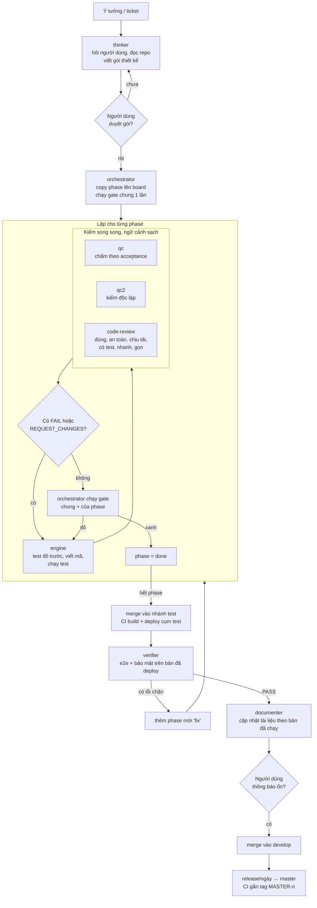

# Quy trình phát triển phần mềm có agent tham gia

Thư mục này mô tả một quy trình phát triển phần mềm mà **agent AI làm phần lớn việc viết mã, kiểm thử và rà soát**. Con người chỉ quyết định điều chỉ con người biết, và duyệt ở các cổng chính. Quy trình đã chạy thật nhiều tháng trên một dự án gateway viết bằng Rust. Tài liệu này đã được tổng quát hoá: bạn không cần biết dự án gốc.

**Dành cho ai:** một đội phát triển muốn áp dụng (hoặc chỉnh lại) quy trình này cho dự án của mình.

## Ý chính trong 6 dòng

1. Không viết mã khi chưa có **gói thiết kế** (PRD, SRS, design, phases) và người dùng đã duyệt.
2. Mỗi phase có **mã yêu cầu** (`REQ-xxx`) và một **lệnh gate** chạy thật. Reviewer nói PASS không đủ để đóng phase. Chỉ lệnh gate xanh mới đóng được.
3. Người **viết mã** và người **kiểm** là các phiên agent khác nhau, mỗi phiên bắt đầu với ngữ cảnh sạch.
4. **Orchestrator** (agent điều phối) không tự sửa mã. Nó chỉ giao việc, merge, chạy gate, deploy và ghi sổ.
5. Mọi mốc đều ghi vào **ticket** và **board**. Ai đến sau cũng trace lại được.
6. Tài liệu nằm trong repo, có cổng kiểm tự động, và cập nhật cùng commit với mã.

## Sơ đồ tổng quan

## Cách dùng thư mục này

| Bạn muốn | Mở |
|---|---|
| Hiểu từng bước và ai làm gì | [`01-quy-trinh.md`](01-quy-trinh.md) |
| Giao việc cho agent (mẫu brief, mẫu báo cáo) | [`02-vai-tro-va-brief.md`](02-vai-tro-va-brief.md) |
| Chuẩn hoá nhánh, tag, phát hành | [`03-gitflow-va-release.md`](03-gitflow-va-release.md) |
| Dựng tài liệu cho agent đọc (CONTEXT, ADR, quy tắc) | [`04-tai-lieu-cho-agent.md`](04-tai-lieu-cho-agent.md) |
| Tránh lỗi đã gặp | [`05-bai-hoc.md`](05-bai-hoc.md) |
| Chép mẫu về repo của mình | [`mau/`](mau/) |
| Cài các skill đã dùng | [`skills/`](skills/README.md) |

### Bắt đầu nhanh (30 phút)

- [ ] Đọc README này và `01-quy-trinh.md`.
- [ ] Chép [`skills/`](skills/README.md) vào thư mục skill của công cụ agent bạn dùng.
- [ ] Chép `mau/CONTEXT-mau.md` thành `CONTEXT.md` ở gốc repo. Điền thuật ngữ và phạm vi của bạn.
- [ ] Chép `mau/CLAUDE-quy-tac-mau.md` vào file quy tắc agent của repo (`CLAUDE.md` hoặc `AGENTS.md`).
- [ ] Tạo `docs/adr/` và chép `mau/adr-mau.md` làm ADR đầu tiên.
- [ ] Chép `mau/check-docs-mau.sh` thành `scripts/check-docs.sh`.
- [ ] Với tính năng đầu tiên: nhờ agent chạy skill `thinker` để sinh gói thiết kế (xem `mau/goi-thiet-ke/` để biết hình dạng).

## Điều kiện để chạy

- Một công cụ agent cho phép **phiên cha sinh phiên con** và gửi tin giữa chúng. Dự án gốc dùng Prime Agent (lệnh `rlm.spawn`, `agent_message.send`). Công cụ khác cũng được, nếu làm được hai việc: giao việc cho phiên con và nhận báo cáo có dòng trạng thái đầu tiên.
- Repo git có CI chạy được lệnh gate (build, lint, test).
- Skill `orchestrator` kèm `scripts/board.py` (có trong `skills/`) để ghi board JSON.
- Nên có nhiều hơn một model. Quy trình hưởng lợi khi người viết và người kiểm dùng model khác nhau. Bảng model ở `02-vai-tro-va-brief.md` chỉ là gợi ý. Hãy chọn theo nhà cung cấp của đội bạn.

## Điều cần chỉnh cho đội của bạn

| Mục | Trong tài liệu | Bạn thay bằng |
|---|---|---|
| Tên model theo vai | `<model-engine>`, `<model-qc>`... | model đội bạn có |
| Lệnh gate | ví dụ `cargo test`, `pytest` | lệnh thật của repo |
| Hệ thống CI | `<ci>` | Jenkins, GitLab CI, GitHub Actions... |
| Địa chỉ nội bộ | `<gitlab>`, `<registry>` | địa chỉ của bạn |
| Ngôn ngữ báo cáo | tiếng Việt có dấu | ngôn ngữ của đội. Giữ nguyên các status token |

> **Lưu ý về ví dụ.** Ví dụ lấy từ một dự án gateway nhiều repo (thư viện lõi, thư viện logic, ứng dụng). Mọi tên đã đổi thành tên chung. Nếu một chi tiết trông quá riêng, coi nó là minh hoạ, không phải quy định.
