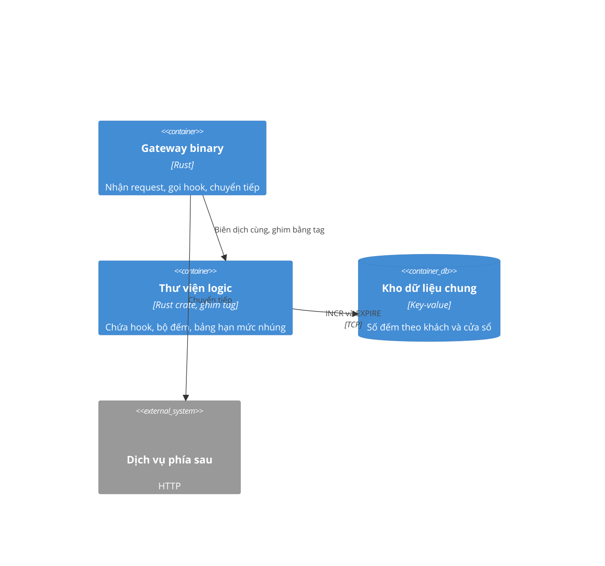

# Giới hạn tốc độ theo khách hàng - Design

## Containers (C4 L2)

- **Thư viện logic:** thêm module `rate_window` (bộ đếm), hook kiểm hạn mức, bảng hạn mức nhúng bằng `include_str!`.
- **Gateway binary:** chỉ đổi dòng khởi tạo hook; ghim tag thư viện mới.
- **Kho dữ liệu chung:** không đổi. Thêm một nhóm khoá có tiền tố riêng.

## Quyết định

### D1 - Đếm bằng cửa sổ cố định chia nhỏ, lưu ở kho dữ liệu chung
**Chọn:** 6 ô 10 giây, mỗi ô một khoá có TTL; số đếm là tổng 6 ô. **Vì:** đủ gần "cửa sổ trượt", chỉ cần lệnh tăng nguyên tử và hết hạn có sẵn.
**Loại:** đếm trong bộ nhớ từng pod - nhanh nhưng số đếm sai khi có nhiều pod. Thuật toán token bucket có script phía kho - chính xác hơn nhưng thêm một đường mã phải bảo trì và kiểm.
**Đánh đổi:** sai số tối đa một ô (10 giây) ở biên cửa sổ.

### D2 - Bảng hạn mức nhúng vào binary, không nạp lại khi chạy
**Chọn:** file JSON nhúng lúc build, nạp một lần khi khởi động. **Vì:** đổi hạn mức đi qua review và deploy, và hỏng thì dừng ngay (fail-closed).
**Loại:** ConfigMap đọc khi chạy - đổi nhanh nhưng thêm một đường triển khai và một trạng thái "bảng đang cũ". Lưu trong cơ sở dữ liệu - thêm phụ thuộc phải sống.
**Đánh đổi:** chỉnh hạn mức khẩn cấp phải phát hành bản mới.

## Vấn đề thiết kế

1. **Giả định không có chủ:** kho dữ liệu chung đủ tải. Chưa ai xác nhận. Đo ở phase 1 trước khi viết hook.
2. **Tài nguyên dùng chung:** cụm test và agent CI. Phase 3 (Demonstration) deploy lên cụm test nên không chạy song song với phase khác cũng deploy.
3. **REQ-002 cần kho thật:** test `#[ignore]`, chạy bằng script gate đầy đủ, không phải `cargo test` trần.
4. **Mơ hồ:** "cửa sổ trượt" có thể hiểu là chính xác hoặc xấp xỉ. Chọn xấp xỉ theo ô (D1), ghi rõ ở REQ-001.

## Test hiện có và yêu cầu

| Test | Yêu cầu | Ghi chú |
|---|---|---|
| `rate_window_test` | REQ-001, REQ-002 | mới |
| `rate_limit_hook_test` | REQ-003, REQ-004 | mới |
| `rate_config_test` | REQ-005 | mới |
| `existing_hook_test` | không thuộc yêu cầu mới | giữ để chứng minh hành vi cũ không đổi |

Mỗi test trong repo hoặc ánh xạ tới một yêu cầu, hoặc có dòng giải thích vì sao không.
