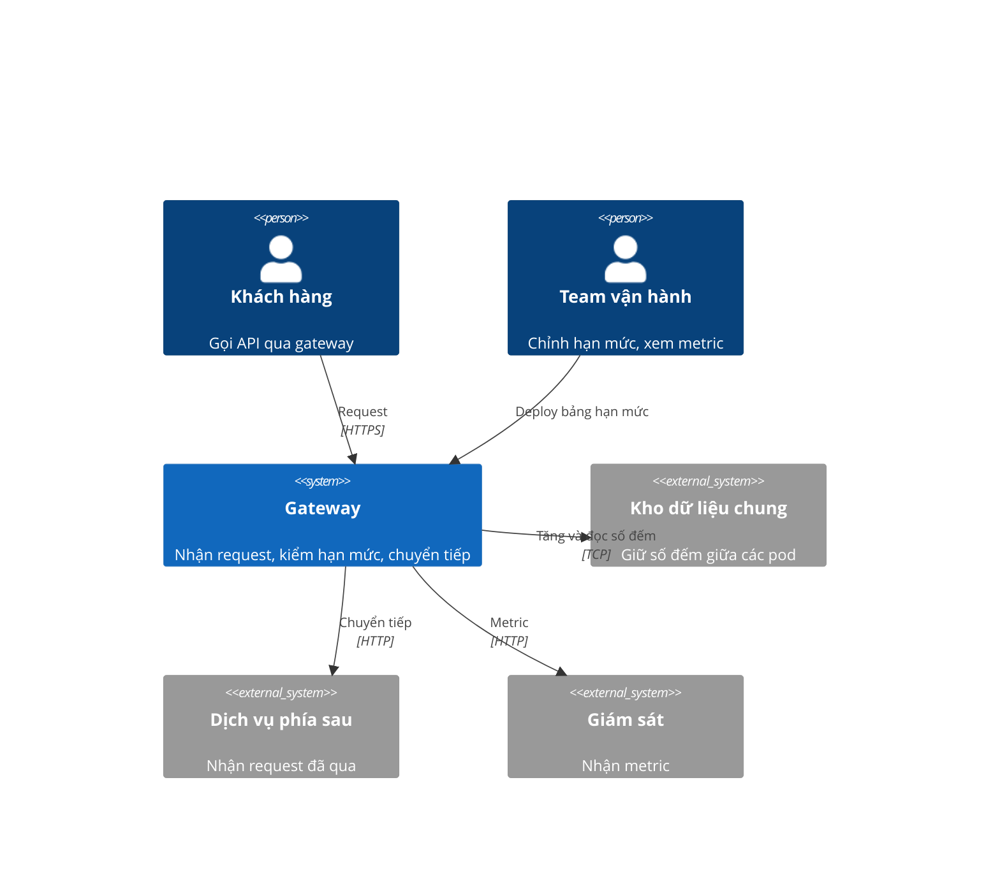

# Giới hạn tốc độ theo khách hàng - SRS

## Bối cảnh hệ thống (C4 L1)

Trong biên: module đếm, móc vào luồng request, bảng hạn mức nhúng, metric. Ngoài biên: kho dữ liệu chung (dùng, không sửa), dịch vụ phía sau. Đi xuyên biên: request vào, số đếm đi và về, metric ra.

## Yêu cầu

| Id | Type | Pri | Yêu cầu | Lý do | Verify |
|---|---|---|---|---|---|
| REQ-001 | FR | must | Bộ đếm phải trả đúng số request của một khách trong cửa sổ trượt 60 giây, kể cả ở biên cửa sổ. | Số đếm sai thì chặn nhầm hoặc bỏ lọt. | Test |
| REQ-002 | FR | must | Nhiều pod phải đếm chung một khoá theo khách; số đếm không lệch quá 1 khi hai pod ghi đồng thời. | Gateway chạy nhiều pod. | Test |
| REQ-003 | FR | must | Khách vượt hạn mức phải nhận 429; khách trong hạn mức giữ nguyên hành vi hiện tại. | Mục tiêu của tính năng. | Test |
| REQ-004 | FR | must | Phản hồi 429 phải có header `Retry-After` bằng số giây còn lại của cửa sổ. | Để client chờ đúng. | Test |
| REQ-005 | FR | must | Bảng hạn mức hỏng, sai kiểu hoặc rỗng phải làm tiến trình dừng lúc khởi động, kèm log nêu tên file và lý do. | Fail-closed, không chạy với luật sai. | Inspection |
| REQ-006 | NFR | should | Metric `rate_limit_rejected_total{tenant}` phải tăng khi có 429 trên cụm test. | Vận hành cần số liệu. | Demonstration |

- **Type:** `FR` chức năng, `NFR` phi chức năng.
- **Pri:** `must` / `should` / `could`.
- **Verify:** `Test` (lệnh tự động), `Demonstration` (quan sát hệ thống đang chạy), `Inspection` (đọc mã, cấu hình hoặc output), `Analysis` (đo, tính, so sánh). Không chọn được một trong bốn thì chưa phải yêu cầu.

## Ràng buộc & giả định

- Kho dữ liệu chung đã có và đủ tải thêm khoảng 2.000 lệnh/giây. **Giả định không có chủ**: ghi là rủi ro, cần đo ở phase 1.
- Hạn mức mặc định 600 request/phút (xem câu hỏi treo ở PRD).
- Hệ thống chuẩn để so hành vi khi trong hạn mức: bản gateway hiện đang chạy.
